<p align="center">
  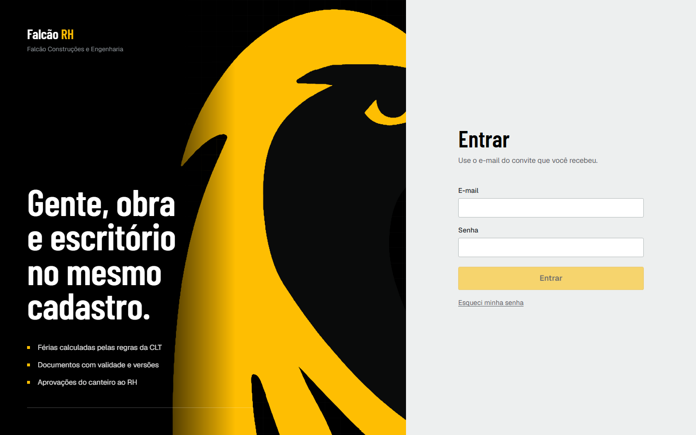
</p>

<h1 align="center">Falcão RH</h1>

<p align="center">
  <strong>Gente, obra e escritório no mesmo cadastro.</strong><br>
  Plataforma de gestão de pessoas da Falcão Construções e Engenharia: colaboradores, estrutura, férias pela CLT, aprovações, documentos com validade e indicadores, com isolamento por empresa e segurança de dados pessoais desde a primeira linha.
</p>

<p align="center">
  <a href="https://github.com/mdevsec-code/Falcao-RH-Management/actions/workflows/ci.yml"></a>
  
  
  
  
</p>

---

## Sumário

- [Telas](#telas)
- [O que o sistema faz](#o-que-o-sistema-faz)
- [Por dentro](#por-dentro)
- [Stack](#stack)
- [Como rodar](#como-rodar)
- [Testes](#testes)
- [Estrutura do projeto](#estrutura-do-projeto)
- [Documentação](#documentação)
- [Próximos passos](#próximos-passos)

---

## Telas

> Todas as capturas usam a organização de demonstração, com pessoas, documentos e pedidos **fictícios**.

<table>
  <tr>
    <td width="50%">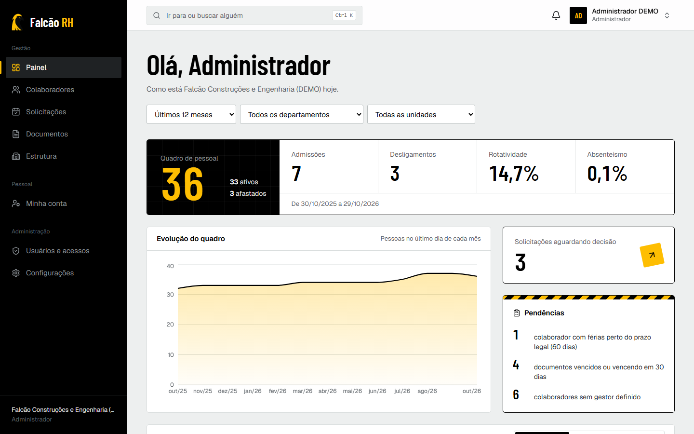<br><sub><b>Painel.</b> Quadro, rotatividade e absenteísmo calculados no banco; pendências com link direto.</sub></td>
    <td width="50%">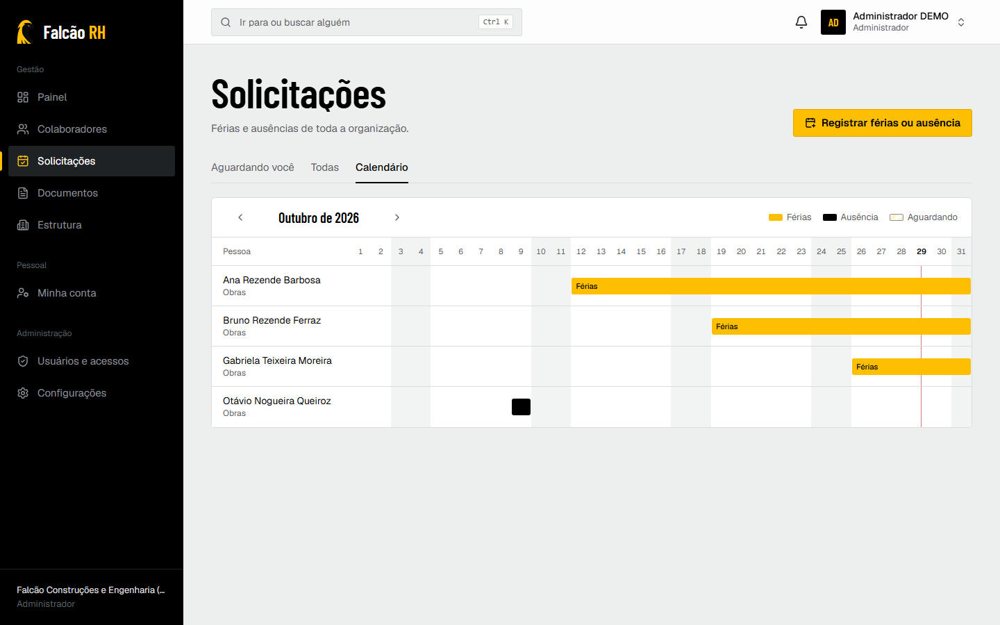<br><sub><b>Solicitações.</b> Fila de aprovação e calendário do mês em linha do tempo.</sub></td>
  </tr>
  <tr>
    <td>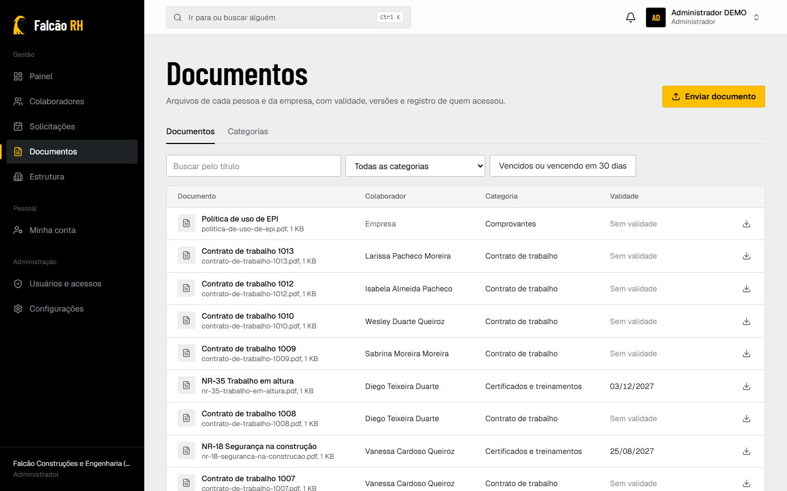<br><sub><b>Documentos.</b> Versões, validade com alerta e download por link temporário.</sub></td>
    <td>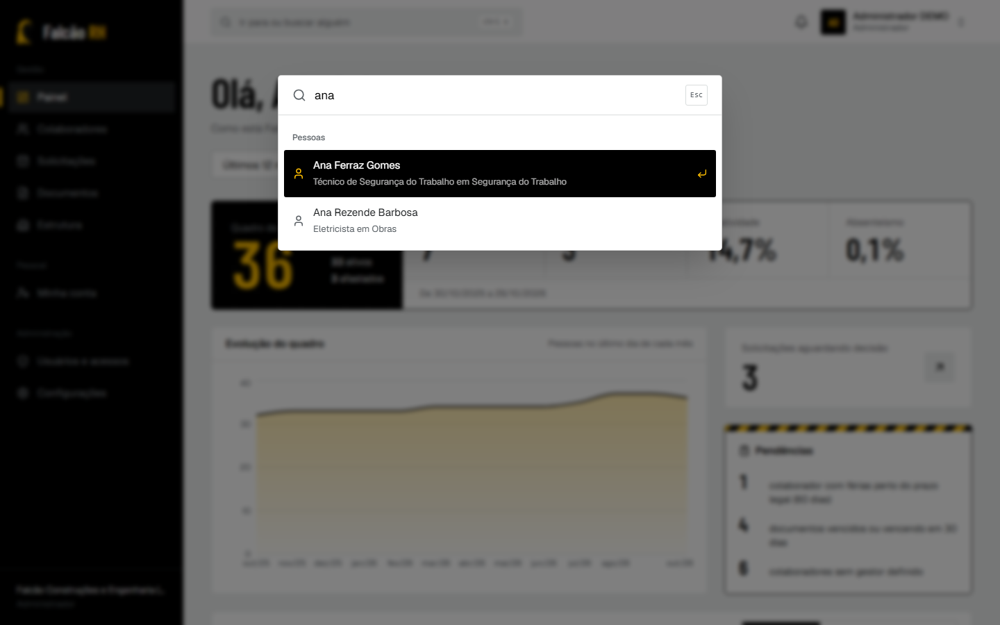<br><sub><b>Paleta de comandos.</b> <kbd>Ctrl</kbd> + <kbd>K</kbd> leva a qualquer tela ou pessoa.</sub></td>
  </tr>
  <tr>
    <td>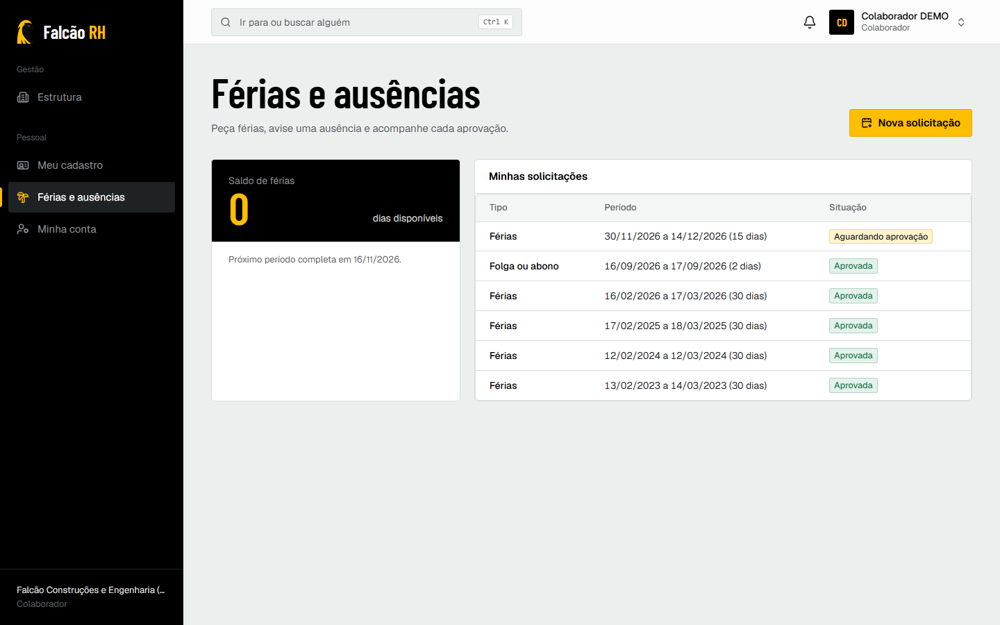<br><sub><b>Férias e ausências.</b> Saldo por período aquisitivo, com prazo legal de cada um.</sub></td>
    <td>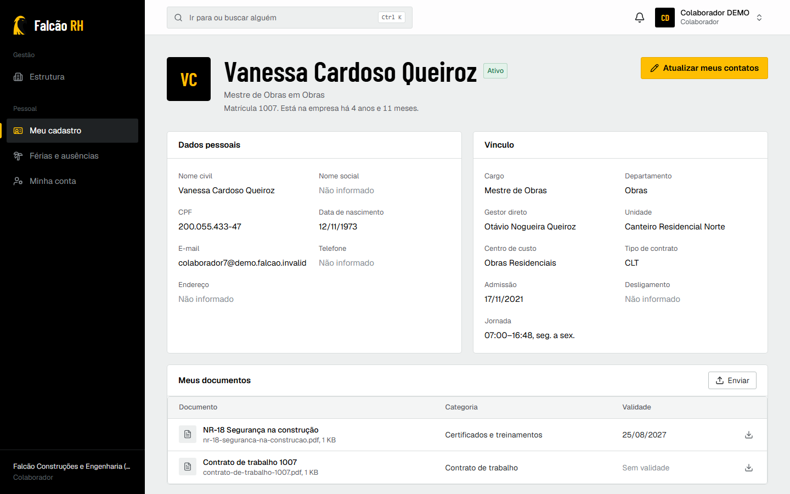<br><sub><b>Portal do colaborador.</b> A própria ficha, os próprios documentos e a trajetória.</sub></td>
  </tr>
  <tr>
    <td>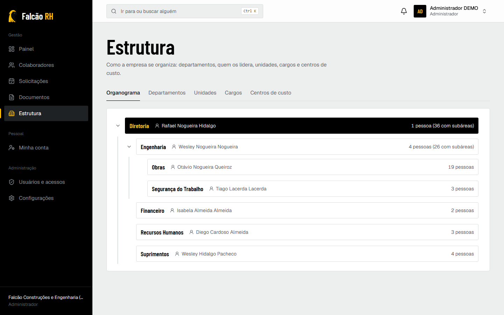<br><sub><b>Estrutura.</b> Organograma navegável, departamentos, cargos e unidades.</sub></td>
    <td>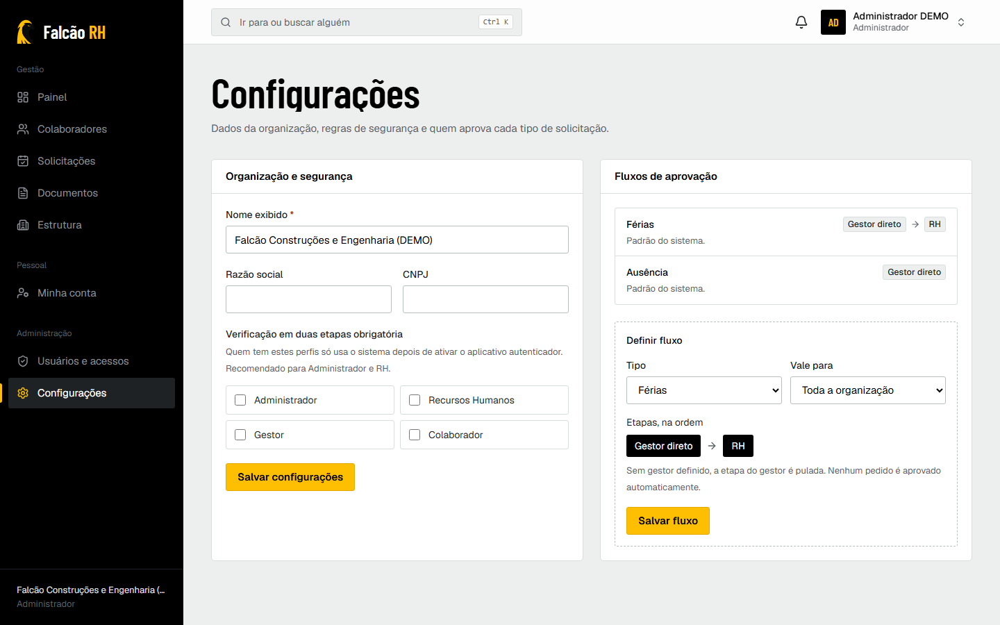<br><sub><b>Configurações.</b> MFA obrigatório por perfil e fluxos de aprovação por departamento.</sub></td>
  </tr>
</table>

<p align="center">
  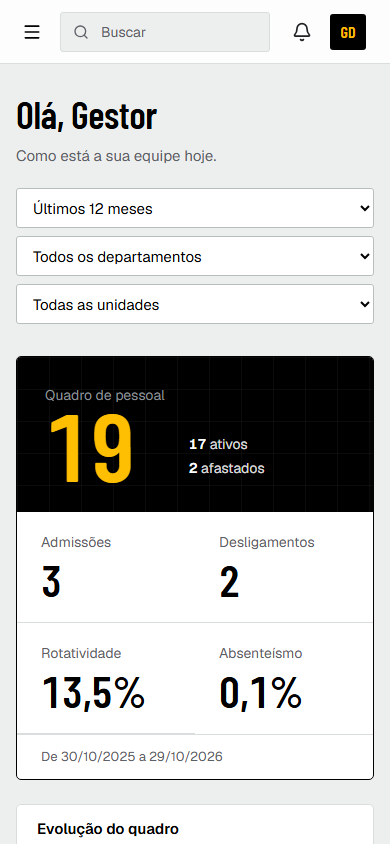
  <br><sub>Pensado para o canteiro: todas as telas funcionam a partir de 360 px.</sub>
</p>

---

## O que o sistema faz

| Área | O que já funciona |
| --- | --- |
| **Colaboradores** | Cadastro com validação de CPF, ficha individual, busca, filtros, histórico funcional automático (admissão, mudanças de cargo, departamento e gestor), afastamento e desligamento com motivo, importação por planilha com prévia linha a linha e exportação em Excel |
| **Estrutura** | Departamentos com hierarquia sem ciclos e gestor, unidades, cargos, centros de custo e organograma interativo |
| **Férias** | Saldo por período aquisitivo com as regras da CLT: 30 dias a cada 12 meses, redução por faltas (art. 130), fracionamento em até 3 partes com uma de 14 dias e nenhuma menor que 5, início fora dos 2 dias antes do repouso, prazo de concessão (art. 134) e alerta antes do pagamento em dobro (art. 137) |
| **Ausências** | Folga, atestado, falecimento, casamento, doação de sangue e falta registrada pelo RH. Atestado é dado de saúde: o gestor vê só "ausência justificada" |
| **Aprovações** | Fluxo configurável por tipo e departamento (gestor, RH ou os dois), fila "aguardando você", comentário obrigatório na recusa, ninguém aprova o próprio pedido |
| **Documentos** | Categorias com regras (visível no portal, envio pelo colaborador, sensível, exige validade), versões imutáveis, tipo verificado pelo conteúdo, link de download de 5 minutos e registro de cada acesso |
| **Notificações** | No sistema e por e-mail, enviados só depois que a ação é gravada |
| **Automações** | Documentos vencendo (30, 7 e 0 dias), aprovações paradas, férias perto do prazo legal, sem aviso repetido |
| **Portal** | O colaborador vê a própria ficha, atualiza contatos, pede férias e ausências e envia documentos pelo celular |
| **Painel** | Quadro de pessoal, admissões, desligamentos, rotatividade, absenteísmo, evolução mensal, distribuição por departamento, unidade e centro de custo, próximas férias, aniversariantes e pendências |
| **Acesso** | Convite por e-mail (sem senha provisória), MFA por aplicativo com QR code e códigos de recuperação, MFA obrigatório por perfil, aparelhos conectados com encerramento remoto, limite de tentativas |
| **Perfis** | Administrador, RH, Gestor (só a equipe, sem dados pessoais sensíveis) e Colaborador (só a si mesmo) |

---

## Por dentro

**Isolamento entre empresas no próprio banco.** Cada transação de domínio fixa a organização e assume uma role do PostgreSQL sujeita a Row Level Security. Sem organização definida, nenhuma linha aparece. Chaves estrangeiras compostas `(tenant_id, id)` impedem que um registro aponte para o departamento de outra empresa (a checagem de FK ignora o RLS). Testes dedicados provam as três camadas.

**Trilha que ninguém apaga.** Auditoria, histórico funcional e versões de documento são somente inclusão, protegidos por gatilho até contra o dono das tabelas. A auditoria guarda quais campos mudaram, nunca os valores pessoais.

**Regras da CLT como funções puras.** `apps/api/src/modules/requests/vacation.ts` decide saldo e validade de cada pedido e é coberto por testes que citam o artigo de cada regra.

**Movimento com propósito.** GSAP orquestra um único momento cinematográfico (a entrada: o falcão revelado por máscara, o título montado letra a letra, a cortina preta e amarela após o login). Nas telas internas, o movimento é curto e informativo: títulos, blocos em cascata, contadores e barras. Quem configurou o sistema para reduzir movimento vê tudo direto, sem animação.

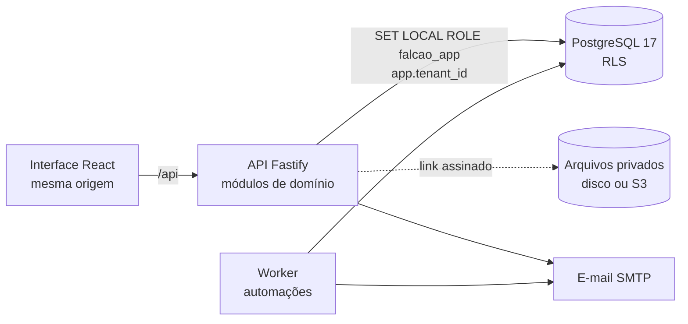

---

## Stack

| Camada | Tecnologia |
| --- | --- |
| Interface | React 19, Vite, TanStack Router e Query, React Hook Form, Tailwind CSS 4, Radix, Recharts, GSAP, Motion |
| API | Fastify 5, Zod (esquemas compartilhados com a interface), Better Auth |
| Dados | PostgreSQL 17, Drizzle ORM, migrações SQL versionadas |
| Arquivos e e-mail | Disco local ou Amazon S3; SMTP (Amazon SES) |
| Testes | Vitest com PostgreSQL real em memória (PGlite), Playwright |
| Infraestrutura proposta | AWS São Paulo: EC2, RDS, S3, SES ([DEPLOYMENT.md](docs/DEPLOYMENT.md)) |

Cada escolha, com as alternativas avaliadas, está em [TECHNOLOGY_DECISIONS.md](docs/TECHNOLOGY_DECISIONS.md) e nos [ADRs](docs/adr/).

---

## Como rodar

Requisitos: Node 22.12+ (recomendado 24) e PostgreSQL 15+ (recomendado 17).

```bash
npm install
cp .env.example .env          # preencha DATABASE_URL, AUTH_SECRET e SEED_*
npm run db:migrate            # tabelas, role falcao_app e políticas RLS
npm run db:seed               # organização "(DEMO)" com dados FICTÍCIOS
npm run dev:api               # API em http://127.0.0.1:3333
npm run dev:web               # interface em http://localhost:5173
npm run dev:worker -w apps/api  # opcional: automações a cada hora
```

O seed cria o administrador com `SEED_ADMIN_EMAIL` e `SEED_ADMIN_PASSWORD`, e mais um usuário de cada perfil com a mesma senha:

| Perfil | E-mail |
| --- | --- |
| RH | `rh@demo.falcao.invalid` |
| Gestor (de Obras) | `gestor@demo.falcao.invalid` |
| Colaborador | `colaborador@demo.falcao.invalid` |

Sem `SMTP_URL`, os e-mails (convites, avisos) aparecem no log da API. O seed recusa rodar com `NODE_ENV=production`.

---

## Testes

```bash
npm run typecheck
npm test                      # 97 testes: contratos, regras da CLT, API e banco com RLS
npm run build
npm run test:e2e              # 15 testes no navegador; exige o ambiente DEMO rodando e E2E_PASSWORD
```

Os testes da API aplicam as mesmas migrações de produção num PostgreSQL em memória. Cobrem isolamento entre empresas, permissões de cada perfil, mascaramento de dados pessoais, fluxo de aprovação de ponta a ponta, privacidade de atestado, documentos (tipo falsificado, link adulterado ou vencido, outra empresa), importação com erros, automações sem aviso duplicado e MFA obrigatório. O CI roda tudo, inclusive o E2E contra um PostgreSQL 17 real.

---

## Estrutura do projeto

```
apps/api            API: módulos de domínio, autenticação, automações, migrações, seed
apps/web            Interface: design system, telas, sistema de movimento
packages/contracts  Esquemas Zod, perfis e permissões compartilhados
e2e                 Testes ponta a ponta e capturas de tela
docs                Produto, arquitetura, banco, segurança, implantação, roadmap e ADRs
```

---

## Documentação

| Documento | Conteúdo |
| --- | --- |
| [Requisitos do produto](docs/PRODUCT_REQUIREMENTS.md) | Análise da referência, módulos, perfis, fluxos e requisitos |
| [Arquitetura](docs/ARCHITECTURE.md) | Monólito modular, camadas, multi-tenancy, design system e movimento |
| [Decisões de tecnologia](docs/TECHNOLOGY_DECISIONS.md) | Matrizes comparativas e escolhas |
| [Banco de dados](docs/DATABASE.md) e [diagrama ER](docs/ERD.md) | Tabelas, regras, índices, dados pessoais, backup |
| [Segurança e LGPD](docs/SECURITY.md) | Controles, bases legais, retenção, incidentes |
| [Implantação e custos](docs/DEPLOYMENT.md) | AWS São Paulo, passo a passo, estimativa mensal, recuperação de desastres |
| [Roadmap](docs/ROADMAP.md) | O que está pronto, pendências, riscos e decisões da Falcão |
| [ADRs](docs/adr/) | Registro das decisões de arquitetura |

---

## Próximos passos

Treinamentos e NRs com validade, controle de jornada e escalas (controle interno, não ponto legal: [ADR-0009](docs/adr/0009-jornada-nao-e-ponto-legal.md)), onboarding e offboarding, recrutamento, avaliação de desempenho, comunicação interna e relatórios em PDF. A lista completa, com as decisões que dependem da Falcão, está no [roadmap](docs/ROADMAP.md).

<p align="center"><sub>Falcão Construções e Engenharia. Dados de demonstração inteiramente fictícios.</sub></p>
