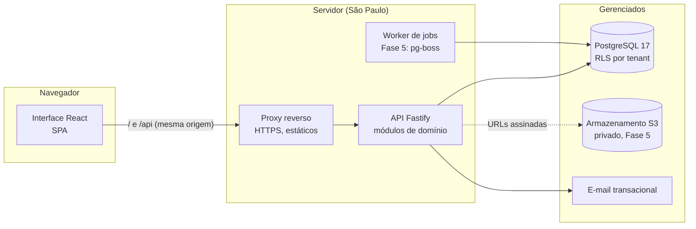

# Arquitetura

## Visão geral

Monólito modular (ADR-0001): uma API, uma interface e um banco, organizados por domínio de negócio. Sem microserviços até que um módulo tenha carga ou ciclo de deploy próprio que justifique.



Interface e API ficam na **mesma origem** (o proxy serve os estáticos e encaminha `/api`). Os cookies de sessão são de primeira parte, `HttpOnly`, `Secure` e `SameSite=Lax`: não há token em `localStorage` e não há CORS entre domínios no caminho principal.

## Camadas da API

```
apps/api/src
  app.ts                 montagem: segurança HTTP, CORS, rate limit, erros, rotas
  server.ts              processo: ambiente, conexões, desligamento limpo
  env.ts                 variáveis validadas por Zod (falha cedo e com mensagem)
  auth/                  Better Auth: login, sessões, MFA, convites
  http/context.ts        sessão → organização → perfil → escopo (Ctx)
  db/
    schema/              tabelas Drizzle (identidade + domínio)
    client.ts            pool, withTenant, withUser
    provision.ts         operações de sistema (seed, testes, CLI)
  lib/                   erros, auditoria, e-mail, datas
  modules/<domínio>/
    <domínio>.routes.ts  HTTP: esquema de entrada, permissão, transação
    <domínio>.service.ts regras de negócio, consultas, auditoria
```

Regras de dependência:
- **Rotas** validam entrada (Zod), exigem permissão (`requirePermission`) e abrem a transação da organização (`tenantTx`). Não contêm regra de negócio.
- **Serviços** recebem a transação (`Tx`) e o contexto (`Ctx`). Nunca recebem o pool: não há como um serviço consultar fora do RLS por engano.
- **Contratos** (`packages/contracts`) são a fonte única dos esquemas de entrada, perfis e permissões, usados igualmente pela API e pela interface.
- Um módulo usa outro só pela função exportada do serviço (ex.: o painel reaproveita `scopeCondition` de colaboradores), nunca pelas tabelas internas de outro módulo diretamente quando houver serviço para isso.

### Ciclo de uma requisição

1. `authenticate` valida a sessão (cookie) com o Better Auth.
2. Lista os vínculos ativos do usuário (`withUser`, sob RLS) e escolhe a organização do cabeçalho `x-tenant-id` ou a única disponível. Organização que não é do usuário → 403.
3. Monta o `Ctx`: usuário, organização, perfil, escopo de dados e ficha vinculada.
4. `requirePermission` confere a permissão do perfil.
5. `tenantTx` abre a transação: `set_config('app.tenant_id')`, `set_config('app.user_id')`, `SET LOCAL ROLE falcao_app`. A partir daqui o PostgreSQL só mostra linhas da organização.
6. O serviço aplica o escopo de dados (equipe ou só o próprio cadastro), executa a regra, grava auditoria na mesma transação.
7. Erros conhecidos viram respostas claras (400 validação, 403, 404, 409 duplicidade, 422 referência inválida); o resto é 500 com log, sem vazar detalhes.

## Multi-tenancy (ADR-0004)

Esquema compartilhado com `tenant_id` em toda tabela de domínio, em três camadas de defesa:

1. **RLS no PostgreSQL.** Políticas `tenant_id = app_tenant_id()` para a role `falcao_app`. Sem organização definida, nenhuma linha aparece.
2. **Chaves estrangeiras compostas** `(tenant_id, id)`. A checagem de FK ignora o RLS; sem elas, um registro poderia apontar para o departamento de outra empresa.
3. **Filtros explícitos na aplicação** onde a política é mais larga de propósito (vínculos: o usuário lê os próprios vínculos em todas as organizações para poder escolher uma).

Testes dedicados (`apps/api/test/tenant-isolation.test.ts`) provam as três camadas.

Bancos separados por cliente não se justificam agora: aumentam custo e operação sem ganho de isolamento relevante frente ao RLS. Se um cliente exigir isolamento físico, o mesmo código roda num banco dedicado (é só outro `DATABASE_URL`).

## Interface

```
apps/web/src
  router.tsx             rotas, proteção por sessão e permissão, carregamento sob demanda
  lib/                   cliente HTTP, sessão, consultas, formatação, tipos
  components/ui/         design system (botões, campos, painéis, gaveta, estados)
  components/app-shell   barra lateral, busca, troca de organização, menu do usuário
  features/              blocos reutilizados entre telas (formulário e ficha do colaborador)
  pages/                 uma tela por rota
```

- **Estado do servidor** com TanStack Query (cache, invalidação após mutações); **estado de URL** (filtros, busca, página) nos parâmetros da rota; **estado local** com `useState`. Nada de dados de negócio em `localStorage`; só a última organização escolhida, como conveniência.
- **Formulários** com React Hook Form + os mesmos esquemas Zod da API. Erros de validação do servidor voltam para o campo certo.
- **Permissões na interface** só escondem o que o perfil não pode usar. A garantia é sempre do backend.

### Design system

Identidade a partir da marca real da Falcão (logo em `Downloads/Logo Falcao.png` e no ERP de Suprimentos):

| Token | Valor | Uso |
| --- | --- | --- |
| `brand` | `#FEBE02` | Item ativo, ação principal, número-chave. Nunca como fundo de área grande |
| `ink` | `#000000` | Barra lateral, títulos, preto do logo |
| `concrete` | `#EDEFEF` | Fundo do app (cinza frio de concreto) |
| `paper` | `#FFFFFF` | Painéis |
| `steel` | `#5B6166` | Texto secundário (o cinza do subtítulo do logo) |
| `ok` / `danger` / `info` | verde, vermelho, azul | Status |

- **Tipografia:** Barlow Condensed (títulos e números, ecoa o letreiro condensado do logo) + Geist (texto de interface), números tabulares em tabelas.
- **Faixa zebrada de obra:** reservada a pendências e alertas, o único elemento ousado da interface.
- **Hierarquia por borda fina**, raio pequeno (3-5 px), sem sombras empilhadas nem gradientes decorativos.
- **Acessibilidade:** foco visível em preto + halo amarelo, rótulos e erros ligados aos campos, `aria-current` na navegação, gráficos com descrição textual, movimento reduzido respeitado.

## Notificações e automações

- **Notificações** são gravadas na mesma transação da ação que as gera; os e-mails ficam numa caixa de saída (`Outbox`) e só saem depois do commit.
- **Automações** (`src/automations`) rodam no processo `worker`, a cada hora, por organização e dentro do RLS: documentos vencendo (30, 7 e 0 dias), aprovações paradas há mais de 2 dias e férias a 60 e 30 dias do prazo legal. `automation_marks` garante um aviso por faixa, mesmo com várias instâncias (ADR-0011).

## Módulos da API

| Módulo | Responsabilidade |
| --- | --- |
| `users` | `/me`, convites, perfis e situação dos acessos |
| `org` | Unidades, centros de custo, cargos, departamentos |
| `employees` | Cadastro, ficha, histórico, portal, importação e exportação |
| `requests` | Férias (regras da CLT em `vacation.ts`, funções puras), ausências, fluxo de aprovação, calendário |
| `documents` | Categorias, envio, versões, download assinado |
| `notifications` | Avisos do usuário |
| `settings` | Dados da organização, MFA obrigatório, fluxos de aprovação |
| `dashboard` | Indicadores calculados no banco |

## Sistema de movimento

GSAP para coreografia (abertura do login, cortina, títulos por caractere, cascata de blocos, contadores, barras) e Motion para o que é de layout (indicadores que deslizam, troca de etapas). Uma curva da marca, um momento cinematográfico por sessão, telas internas abaixo de 1 s, e nada anima para quem pediu menos movimento. Detalhes no ADR-0012.

## Testes

| Nível | Ferramenta | O que cobre |
| --- | --- | --- |
| Unitário | Vitest | CPF, permissões, esquemas, datas |
| Integração / API / banco | Vitest + PGlite | Migrações reais, RLS, isolamento, permissões, regras, auditoria |
| Ponta a ponta | Playwright | Login, painel, cadastro, ficha, organograma, celular |
