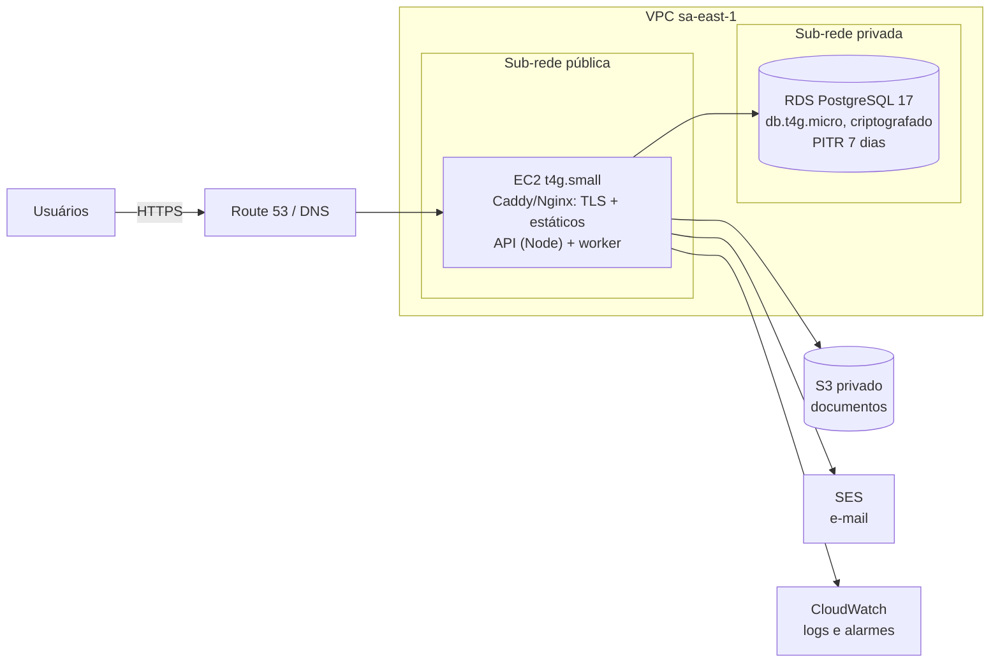

# Implantação, infraestrutura e custos

## Recomendação

Tudo na **AWS, região São Paulo (sa-east-1)**: menor latência para os usuários (canteiros e sede no Brasil), dados pessoais armazenados no país, rede privada entre aplicação e banco, e um caminho de crescimento sem migração de provedor. Justificativa e alternativas em [TECHNOLOGY_DECISIONS.md](TECHNOLOGY_DECISIONS.md#hospedagem) e ADR-0010.

### MVP (Falcão, até ~500 colaboradores)



- Uma instância roda proxy, API e worker de automações (`node apps/api/dist/worker.js`), processos separados gerenciados por systemd ou Docker Compose.
- Documentos no S3 (`STORAGE_DRIVER=s3`), bucket privado com bloqueio de acesso público e criptografia padrão; a instância acessa por perfil IAM, sem chave fixa.
- Banco sem IP público; só a instância acessa (security group).
- Segredos no AWS Systems Manager Parameter Store (SecureString), lidos no início do processo. Nada de `.env` com segredo de produção em disco versionado.

### Crescimento (vários tenants, milhares de colaboradores)

- **Aplicação:** ECS Fargate, 2+ tarefas da API e 1+ do worker atrás de um Application Load Balancer, em duas zonas.
- **Banco:** RDS db.t4g.medium (ou maior) **Multi-AZ**, PITR de 35 dias, réplica de leitura para relatórios pesados.
- **Borda:** CloudFront servindo a interface e protegendo a API (AWS WAF com regras gerenciadas).
- **Cache e rate limit compartilhado:** ElastiCache (Valkey/Redis) quando houver mais de uma instância da API.

## Estimativa de custos mensais

Valores **aproximados em US$**, baseados em preços públicos de outubro de 2026 levantados por agregadores de terceiros ([Sparecores](https://sparecores.com/database/aws/db.t4g.micro), [Bytebase](https://www.bytebase.com/dbcost/rds/instance/db.t4g.micro/)). sa-east-1 costuma custar 30 a 60% mais que us-east-1. **Valide na [AWS Pricing Calculator](https://calculator.aws/) antes de contratar.**

| Item | MVP | Crescimento |
| --- | --- | --- |
| Computação | EC2 t4g.small + 30 GB: ~US$ 20 | Fargate 2×API + 1×worker (0,5 vCPU / 1 GB): ~US$ 60 |
| Balanceador | não usa | ALB: ~US$ 25 |
| Banco | RDS db.t4g.micro Single-AZ + 20 GB gp3: ~US$ 30 | db.t4g.medium Multi-AZ + 100 GB: ~US$ 160 |
| Backups extras | ~US$ 2 | ~US$ 10 |
| Arquivos (S3) | ~US$ 1 | ~US$ 5 |
| E-mail (SES) | < US$ 1 | ~US$ 3 |
| DNS, CloudWatch, Parameter Store | ~US$ 5 | ~US$ 20 |
| CDN + WAF | não usa | ~US$ 20 |
| Cache | não usa | ElastiCache t4g.micro: ~US$ 15 |
| Monitoramento de erros (Sentry) | plano gratuito ou Team | ~US$ 26 |
| **Total aproximado** | **~US$ 60/mês** | **~US$ 340/mês** |

Comparação honesta: uma VPS (como a da Falcão) com o banco na mesma máquina sairia por ~US$ 10-15/mês, mas sem PITR, sem criptografia gerenciada, sem failover e com o banco de dados pessoais a cargo da equipe. A diferença (~US$ 45/mês) é o preço de não autogerir o banco, e é a recomendação para dados de RH.

## Passo a passo do primeiro deploy

1. **Conta e rede:** conta AWS dedicada (ou organização com conta de produção separada), MFA no root, VPC com sub-redes pública e privada em duas zonas.
2. **Banco:** RDS PostgreSQL 17, criptografia KMS, sub-rede privada, retenção de backup 7 dias, `rds.force_ssl=1`. Crie o banco `falcao_rh` e um usuário dono (`falcao_rh`) com senha forte guardada no Parameter Store.
3. **Instância:** EC2 t4g.small (Amazon Linux 2023 ou Ubuntu LTS ARM), Node 24, Caddy (TLS automático) ou Nginx + Certbot. Acesso por SSM Session Manager, sem porta 22 aberta.
4. **Variáveis:** `NODE_ENV=production`, `DATABASE_URL` com `sslmode=require`, `AUTH_SECRET` (48 bytes aleatórios), `WEB_ORIGIN` e `API_URL` com o domínio público, `HOST=127.0.0.1` (só o proxy expõe a API).
5. **Build e migração:**
   ```bash
   npm ci
   npm run build
   node --env-file=.env apps/api/dist/db/migrate.js   # ou npm run db:migrate
   ```
6. **Processos:** `node apps/api/dist/server.js` como serviço systemd com reinício automático; o proxy serve `apps/web/dist` e encaminha `/api` para `127.0.0.1:3333`, com SPA fallback para `index.html`.
7. **Primeira organização e administrador:** por script de sistema (`createTenant`, `createUserWithPassword`/convite), nunca pelo seed de demonstração, que é bloqueado em produção.
8. **E-mail:** verificar o domínio no SES, sair do sandbox, criar credenciais SMTP e definir `SMTP_URL` e `MAIL_FROM`. A API recusa iniciar em produção sem `SMTP_URL`.
9. **Arquivos:** bucket S3 privado em sa-east-1, `STORAGE_DRIVER=s3` e `S3_BUCKET`; perfil IAM da instância com `s3:PutObject` e `s3:GetObject` só nesse bucket.
10. **Automações:** serviço systemd para `node apps/api/dist/worker.js` (roda a cada hora; pode ter mais de uma instância sem avisos duplicados).
11. **Observabilidade:** logs para o CloudWatch, alarmes de CPU, conexões e armazenamento do RDS, health check em `/health`.

Exemplo de proxy (Caddy):

```
rh.falcao.example {
  encode zstd gzip
  handle /api/* {
    reverse_proxy 127.0.0.1:3333
  }
  handle {
    root * /srv/falcao-rh/apps/web/dist
    try_files {path} /index.html
    file_server
  }
  header {
    Strict-Transport-Security "max-age=31536000; includeSubDomains"
    X-Content-Type-Options nosniff
    Referrer-Policy strict-origin-when-cross-origin
  }
}
```

## CI/CD

O GitHub Actions (`.github/workflows/ci.yml`) roda a cada push: tipos, testes, build e a suíte ponta a ponta contra um PostgreSQL 17 real com os dados de demonstração. Próximo passo: na `main`, deploy por SSM: copia o build, roda migrações, reinicia o serviço, verifica `/health`. Migrações rodam antes da troca de versão e devem ser compatíveis com a versão anterior (expandir, migrar, contrair).

## Backup e recuperação de desastres

| Cenário | Como recuperar | Objetivo |
| --- | --- | --- |
| Erro humano (dados apagados) | PITR do RDS para um banco novo, extrair as linhas, reinserir | RPO 5 min, RTO 2 h |
| Instância da aplicação perdida | Nova instância a partir do script de provisionamento + último build | RTO 1 h |
| Falha da zona | MVP: restaurar snapshot em outra zona. Crescimento: Multi-AZ automático | MVP RTO 4 h; crescimento < 2 min |
| Conta comprometida ou exclusão em massa | `pg_dump` diário criptografado em outra conta AWS | RPO 24 h |

Teste de restauração mensal, registrado. Os segredos de recuperação ficam com duas pessoas nomeadas pela Falcão.
