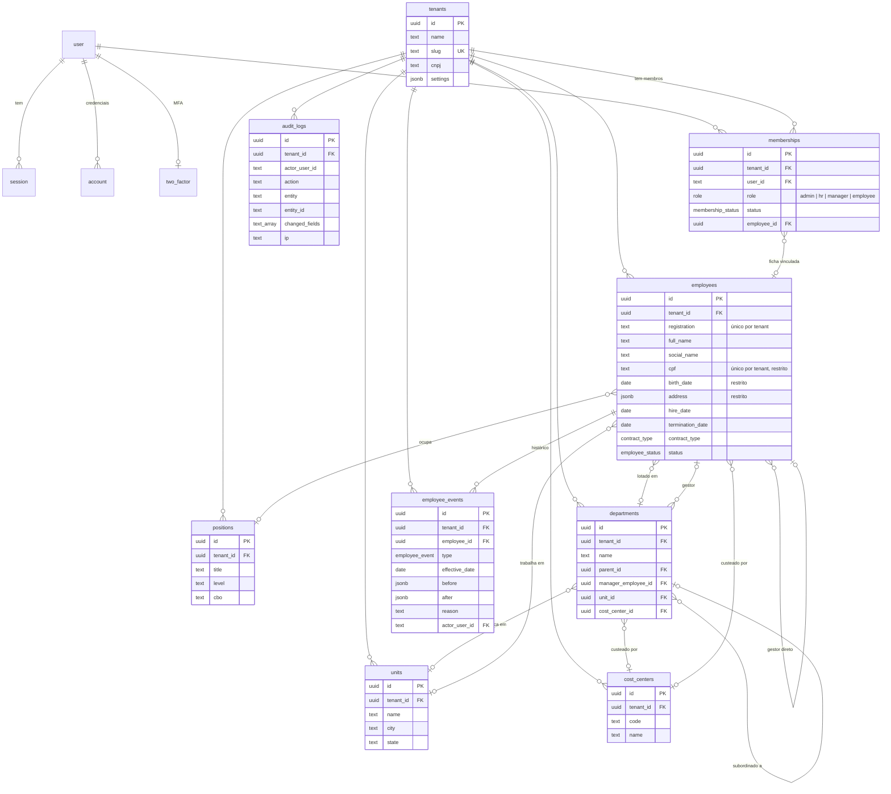
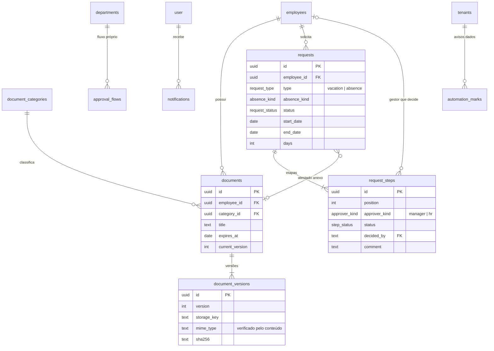

# Diagrama entidade-relacionamento

Estado após as migrações `0000_init` e `0001_security`. Toda relação entre tabelas de domínio também é garantida por chave composta `(tenant_id, id)`, para impedir referências entre organizações.

## Fase 5: documentos, solicitações e notificações

Saldo de férias não é tabela: é calculado a partir da admissão, das férias aprovadas ou pendentes e das faltas injustificadas (CLT art. 130), sempre igual ao que a regra diz.

Detalhes e ordem de entrega em [ROADMAP.md](ROADMAP.md).
